<div align="center">

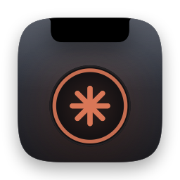

# Earshot

**Every Claude Code session, in your MacBook notch.**<br>
See what each terminal is doing, approve requests without switching windows, and decide which commands need a yes.

[](https://github.com/knQzx/earshot/releases/latest)
[](https://github.com/knQzx/earshot/actions/workflows/ci.yml)


[](LICENSE)


<sub>Unofficial. Not affiliated with or endorsed by Anthropic. Claude and Claude Code are trademarks of Anthropic.</sub>

</div>

Each running `claude` session gets a small spark next to the notch. Hover the notch to see every session, click one to jump to its terminal tab, and answer permission requests right in the notch. Optional policy rules make risky commands like `git push` wait for you, or block them outright.

## Contents

- [What you see](#what-you-see)
- [Features](#features)
- [Why another notch app?](#why-another-notch-app)
- [Install](#install)
- [Using it](#using-it)
- [Policy](#policy)
- [How it works](#how-it-works)
- [Supported terminals](#supported-terminals)
- [Uninstall](#uninstall)
- [Privacy](#privacy)
- [FAQ](#faq)

## What you see

<p align="center">
  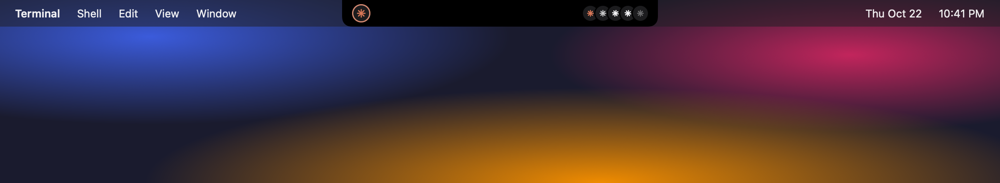
</p>

Every session is a Claude-style spark in a small circle. There are only three looks:

| Spark | Meaning | Labels you will see |
|---|---|---|
| white, spinning | working | "Working", or "No activity" when a working session has been silent for a while (the spark stops and breathes instead) |
| clay, hopping | needs you | "Needs approval" and "Needs an answer" (with an expanding ring), "Ready for review" when Claude has finished and you have not looked yet, "Stopped" after an error |
| grey, still | resting | "Idle", "Interrupted", "No data yet" |

Most labels come with how long the session has been in that state, like "Needs approval · 5 min". Sessions that need you sort to the top.

Each row shows the session's title, with its folder (`~/code/web-app`) underneath. The title is the name you gave the session with `/rename`, otherwise the title Claude Code generated for it, otherwise its automatic name, otherwise the first line of your first prompt. Without any title the folder name is the main label.

<p align="center">
  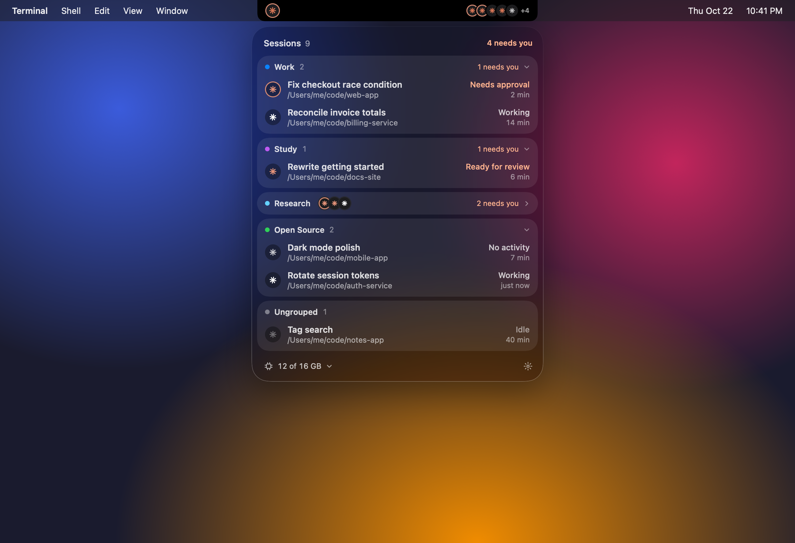
</p>

## Features

- **Two states.** The black notch, and a glass panel below it. Hover the notch (or click it, or press ⌃⌥C) to open the panel
- **Approve in the notch.** A request grows the notch into a small pill with the session, the command and Deny and Allow. The terminal dialog keeps working at the same time
- **Finished pill.** When a session finishes, the notch shows the first line of Claude's answer with Later and Open
- **A notification stack.** Approvals, finished sessions, memory warnings and blocked commands queue up behind each other in the notch. Pills that time out land in a Missed list in the panel, and the notch shows how many you missed
- **Policy.** A catalog of risky commands (pushes, deploys, destructive commands, package installs, secrets and more) that you can set to Ask or Block, plus your own patterns. Out of the box it asks before `git push`, force pushes and edits to Earshot's or Claude Code's own settings. It only ever makes Claude Code stricter
- **Memory alerts.** When macOS runs low on memory, the notch says which Claude session uses the most and offers to stop its biggest helper process, after a confirmation
- **Memory and CPU module.** System memory pressure, compressed memory, swap and CPU, plus the memory and CPU of every Claude session including its MCP servers and tools
- **Jump to the terminal.** Exact tab in Terminal.app and iTerm2, the right pane in tmux
- **Groups.** Drag one session onto another to group them. Folders are remembered, so new sessions started there join on their own
- **From the terminal.** `earshot-hook --list` prints every session as a table, and `--simulate` shows test pills
- **Claude Code plugin.** Connect through `/plugin install` instead of editing `settings.json`
- **External displays.** On a display without a notch, Earshot shows a small pill at the top of the screen
- Native Swift (AppKit and SwiftUI), Apple Silicon and Intel, macOS 14 or newer
- No network code, no telemetry, no third-party dependencies

## Why another notch app?

There are already good apps for this, such as Coucou, vibe-notch and notchi. They do more, and if you want more features you should try them.

Earshot tries to stay small enough to read before you let it near your permission prompts. It has no dependencies and no network code at all (CI fails if any appears). Run `make loc` to see how big it is.

## Install

You need macOS 14 or newer.

### From source

Requires Xcode 16 or newer (or a Swift 6 toolchain with the macOS SDK). Build with Xcode 26 if you want the Glass island style; Xcode 16 builds simply leave it out. Release builds use Xcode 26.

```sh
git clone https://github.com/knQzx/earshot.git
cd earshot
make install   # builds build/Earshot.app, copies it to ~/Applications and opens it
make hooks     # adds Earshot's hooks to ~/.claude/settings.json
```

Instead of `make hooks` you can click "Install hooks" in the panel the first time you open it, or use the Claude Code plugin below.

Then start a new `claude` session. Sessions that were already running keep their old hook configuration until you restart them.

#### Optional: a stable signature for local builds

Builds are ad-hoc signed, so macOS sees every rebuild as a new app and asks again whether Earshot may control your terminal. If you build often, run this once:

```sh
make signing-identity
```

It runs `scripts/signing-identity.sh`, which uses `openssl` to create a self-signed certificate called "Earshot Local" (RSA 2048, valid for 10 years, usable only for code signing), imports it with its private key into your login keychain, lets `codesign` use the key, and marks the certificate as trusted for code signing (macOS may ask for your password for that step). From then on `scripts/bundle.sh` signs local builds with it instead of ad-hoc, so the Automation permission survives rebuilds. CI and release builds never use it. The certificate is only trusted on your Mac and means nothing anywhere else.

To remove it, delete the "Earshot Local" certificate and its key in Keychain Access, or run:

```sh
security delete-identity -c "Earshot Local" -t ~/Library/Keychains/login.keychain-db
```

<p align="center">
  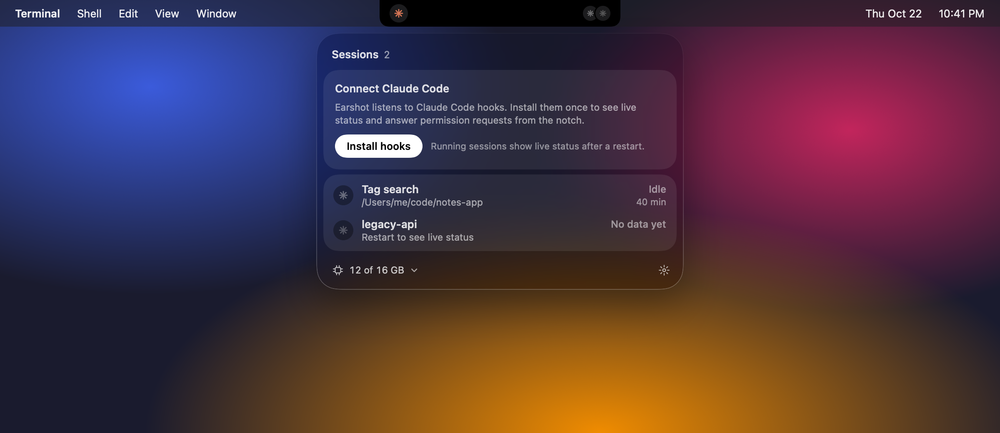
</p>

### From a release zip

1. Download `Earshot-vX.Y.Z.zip` from the [releases page](https://github.com/knQzx/earshot/releases) and unzip it.
2. Move `Earshot.app` to `~/Applications`.
3. The app is ad-hoc signed, not notarized, so macOS blocks the first launch. Open it once, then go to System Settings > Privacy & Security and click "Open Anyway". Or remove the quarantine flag in Terminal:

   ```sh
   xattr -dr com.apple.quarantine ~/Applications/Earshot.app
   ```

4. Connect it to Claude Code with the "Install hooks" button in the panel, the plugin below, or from the terminal:

   ```sh
   ~/Applications/Earshot.app/Contents/MacOS/earshot-hook --install
   ```

### Hooks as a Claude Code plugin

Instead of writing hooks into `~/.claude/settings.json`, you can connect Claude Code through the plugin in this repository. Install the app first, then in Claude Code:

```
/plugin install earshot --marketplace knQzx/earshot
```

That one-step form needs a recent Claude Code (v2.1.275 or later). On older versions add the marketplace first:

```
/plugin marketplace add knQzx/earshot
/plugin install earshot@earshot
```

The plugin is a small shell script that hands every hook event to `earshot-hook` inside `~/Applications/Earshot.app` or `/Applications/Earshot.app`. If the app is not there it does nothing, and if Earshot's hooks are also in `settings.json` it stays quiet so events are not sent twice. The gear menu shows "Hooks: via Claude Code plugin" when it is active.

### Homebrew

There is no official Homebrew cask: homebrew/cask only accepts notarized apps, and notarization needs a paid Apple developer account. A tap formula that builds from source lives in [`packaging/homebrew/earshot.rb`](packaging/homebrew/earshot.rb).

## Using it

- **Hover** the notch for a moment to open the panel. It closes again shortly after the pointer leaves the notch and the panel. "Open on hover" can be turned off in Settings.
- **Click** the notch, or press **⌃⌥C** anywhere, to open or close the panel. A panel opened this way stays until you click outside or press Esc.
- **Click a session** in the panel to jump to its terminal. That also marks "Ready for review" as seen.
- **The gear** in the panel footer, or a right-click on the notch, opens a menu with Settings…, the hook status with Install or Uninstall Hooks, Launch at Login and Quit. Settings has two tabs, General and Policy.

### Approving from the notch

When Claude asks for permission and the panel is closed, the notch grows into a pill with the session, the command and two buttons, Deny and Allow. Click anywhere else on the pill to open the panel with the full request card:

- **Allow** (or ⌘↩) runs the tool once
- **Always** allows it and also saves the permission rule Claude Code suggested for it, like the "don't ask again" option in the terminal. It only appears when Claude Code offers such a rule
- **Deny** (or ⌘⌫) refuses, and Claude sees "Denied from Earshot"
- the terminal button jumps to the session instead

<p align="center">
  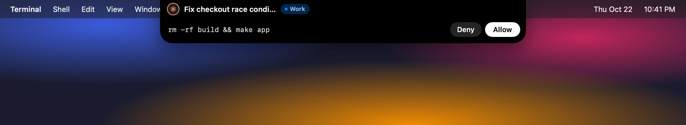
</p>

<p align="center">
  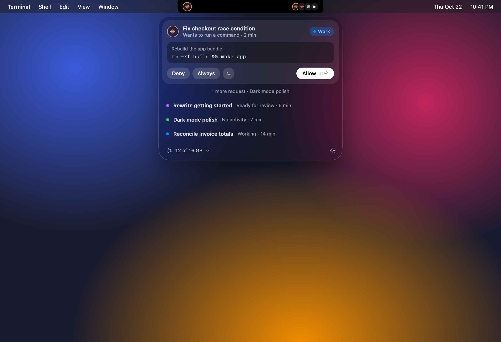
</p>

The safety model:

- **Nothing is approved without a click.** Earshot answers `allow` only after you click Allow or Always, or press ⌘↩. It has no rules that approve anything by themselves; the policy can only add prompts and blocks.
- **The terminal dialog stays live.** For ordinary permission requests Claude Code shows its own dialog at the same time. Answer wherever is closer; the first answer wins. If you answer in the terminal, the pill disappears. If you press Esc in the terminal, the request is withdrawn and the session shows "Interrupted". If the app is closed or has crashed, the terminal dialog decides alone.
- **Policy asks are different.** For a command that one of your policy rules set to Ask, the hook holds Claude before its own permission check until you answer in the notch, so there is no terminal dialog for it (see [Policy](#policy)).
- **Deny rules still win.** Claude Code only asks the permission hook when it would otherwise show you a dialog, so anything your Claude Code settings deny is denied before Earshot hears about it. Policy answers cannot override your deny and ask rules either: Claude Code evaluates them whatever a `PreToolUse` hook returns.
- **No accidental clicks.** New buttons ignore clicks and shortcuts for their first 400 ms, so a pill that appears under your cursor cannot be approved by a click meant for something else.

Questions from Claude (the multiple choice prompts) make the session hop so you notice them, but you answer them in the terminal.

### Finished sessions

When a session finishes its turn and you have not looked at it yet, the notch shows its title, "Done · just now", the first line of Claude's answer and two buttons. Open jumps to the terminal, Later hides the pill and leaves the session hopping in the notch. The pill hides itself after 8 seconds, but not while the pointer is over it. "Notify when a session finishes" in Settings turns it off.

<p align="center">
  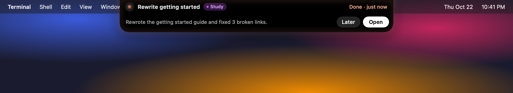
</p>

### The notification stack and Missed

Approvals, finished sessions, memory warnings and blocked commands share the notch. The most important one is in front (approvals first), the others wait behind it and peek out under its edge with a "+N" count. Hover the stack to fan it out. Approvals stay until you answer them; the others hide after a few seconds.

Anything that hid itself before you saw it goes to the Missed list at the top of the panel, and the spark on the left of the notch shows how many you missed. Each entry has Open (or Details for blocked commands), and Clear empties the list.

<p align="center">
  
</p>

<p align="center">
  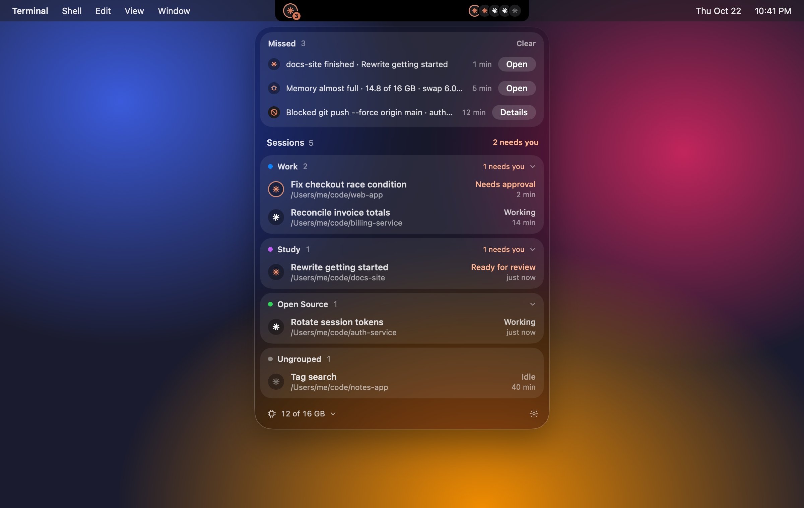
</p>

### Memory alerts

Earshot checks system memory every 10 seconds. When macOS reports memory pressure, or swap is more than 80% full, the notch shows "Memory is running low" (or "Memory is almost full") with the used memory and swap, the Claude session that uses the most memory, and its biggest helper process. Two buttons:

- **Stop** sends that helper process (an MCP server, a language server, a test run) a normal termination signal, after you click Confirm. It only works for processes started by one of your Claude sessions, never for the `claude` process itself or anything else on your Mac
- **Open** jumps to the session's terminal

The same warning does not come back for 10 minutes unless it gets worse.

<p align="center">
  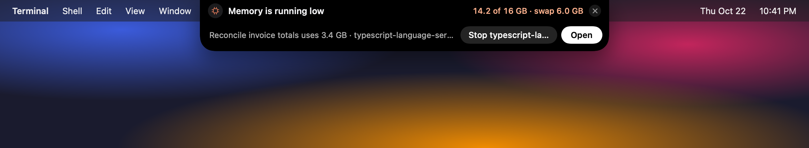
</p>

### Memory and CPU

Click the memory button in the panel footer to open the Memory and CPU module. It shows memory pressure, used, compressed and swap memory, overall CPU, and the total for all Claude sessions. While it is open, each row shows the memory and CPU of that `claude` process together with everything it started, such as MCP servers and tool processes. These per-process numbers are sampled every 2 seconds, and only while the module is open.

<p align="center">
  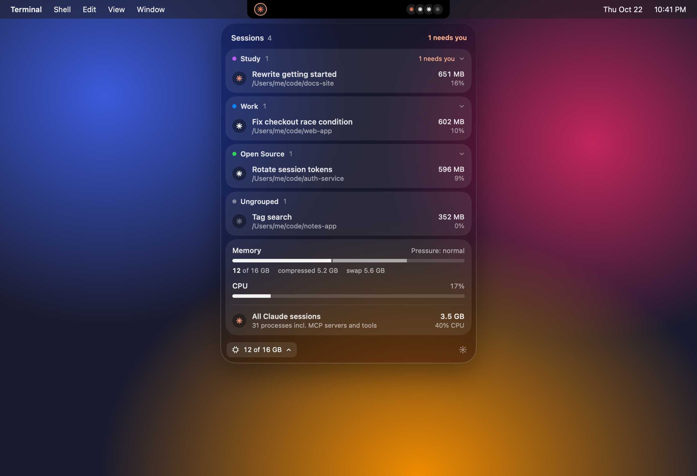
</p>

### Groups

Drag a session onto another one and drop it on "Create group". Earshot suggests a name (Work, Study, Research, Open Source and a few more), and you can type your own and pick a color. Drag more sessions onto the group's header to add them, or drag a session out to remove it. Right-click a group header to rename it, choose from all 9 colors, collapse it or delete it. A collapsed group shows a small stack of sparks so you still see what its sessions are doing.

Groups remember the folders of their sessions. A new session started in one of those folders (or below it) joins the group automatically. Your home folder and `/` are never remembered.

<p align="center">
  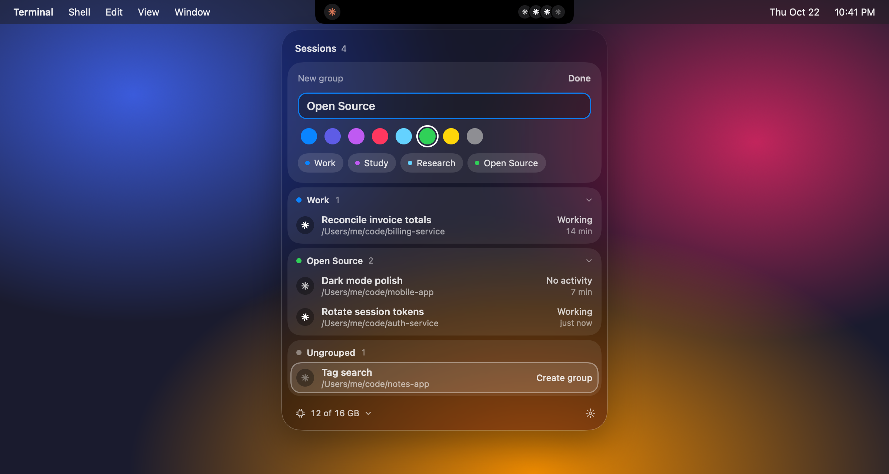
</p>

### Settings

General:

- Show on: the built-in display with the notch, or the main display
- Island style: Black, or Glass on macOS 26 and newer (when built with Xcode 26)
- Launch at login
- Open on hover (on by default)
- Notify when a session finishes (on by default)
- Open the panel on new requests (off by default)
- Play sounds (on by default)
- After how many minutes a silent session counts as "No activity" (5 by default)

Policy: see the next section.

### From the terminal

```sh
~/Applications/Earshot.app/Contents/MacOS/earshot-hook --list
```

prints every session Earshot knows about as a table with its status, project, how long it has been in that state, its tty and what it is doing now. Other commands:

| Command | What it does |
|---|---|
| `earshot-hook --install` / `--uninstall` | adds or removes Earshot's hooks in `~/.claude/settings.json` |
| `earshot-hook --status` | prints `installed`, `outdated`, `viaPlugin` or `notInstalled` |
| `earshot-hook --simulate <kind>` | shows a fake `approval`, `finished`, `memory`, `memory-critical`, `blocked` or `jump` notification in the running app, or a `burst` of several. Simulated pills are marked "Simulated", and a simulated approval is never sent to Claude |
| `earshot-hook --version` | prints the version |

## Policy

Claude Code's own permission rules decide when you get asked. Earshot's policy adds a second layer on top: commands that should always wait for you, or never run, also when Claude Code runs in auto mode. The policy can only make things stricter. It never approves anything on its own.

Open Settings > Policy. The catalog groups common risky actions:

| Group | Rules |
|---|---|
| Git | git push, git commit, force push, git reset --hard, deleting branches, git rebase, git clean -f |
| Release & deploy | npm/pnpm/yarn/bun publish, docker and podman push, kubectl apply and delete, terraform and OpenTofu apply and destroy, helm install and upgrade, gh pr merge and gh release create, fly deploy and vercel --prod |
| Destructive | recursive delete outside the project, sudo, destructive SQL in database shells, recursive chmod or chown outside the project |
| Packages | adding packages with npm, pnpm, yarn, bun, pip, uv, poetry, Homebrew, Cargo and Go |
| Network | curl, wget and httpie to anything but localhost, scp, sftp and rsync to a remote, ssh |
| Secrets | reading or copying `.env` files, keys, `~/.ssh` and cloud or registry credentials |
| Files | edits outside the session's folder |

Each rule is Off, Ask or Block. **By default only these ask:** `git push`, force pushes, and a built-in rule that asks before Claude edits Earshot's own files or Claude Code's settings. Everything else is off until you turn it on.

- **Ask** holds the tool call and shows the approval pill in the notch, labeled with the rule. Allow lets it continue, Deny refuses it. Claude waits until you answer
- **Block** refuses the call right away and shows a "Blocked" pill with the rule and the command. Claude is told which rule blocked it

<p align="center">
  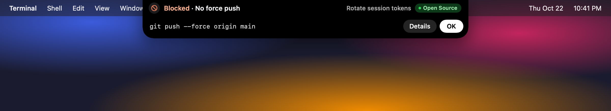
</p>

### Your own rules

Type a command at the top of the Policy tab, choose Ask or Block, and click Add. "More options…" lets you name the rule and pick which tools it applies to (shell commands, file edits, file reads, web fetches, MCP tools or any tool).

- `*` matches anything: `docker compose down*`, `npm run deploy*`
- Spaces match any amount of whitespace, and a command may be called by its full path (`git push*` also catches `/usr/bin/git push`)
- Several commands separated by commas become several rules
- Start a pattern with `regex:` to write a regular expression, for example `regex:^make\s+(release|publish)\b`
- Shell patterns are checked against every part of a chained command, so `git push*` also catches `cd app && git push`, commands inside `sh -c "..."` and commands behind prefixes like `env`, `sudo`, `nohup` or `time`
- When several rules match, Block wins over Ask

The policy lives in `~/Library/Application Support/Earshot/policy.json`. "Edit policy.json…" opens it, and "Reset to Defaults…" puts everything back.

### How the policy works, and its limits

Earshot's `PreToolUse` hook runs before each tool call, before Claude Code's own permission check. The hook reads `policy.json` itself, so the rules apply even when the app is closed:

- **Block**: the hook answers "deny" on its own, with or without the app
- **Ask**: the hook asks the app and holds Claude (up to 24 hours) until you answer in the notch. Clicking Allow lets the call continue only when every part of the command is covered by the rule you are answering; for a chained command with other parts, Claude Code's own permission flow takes over for the rest, exactly as without Earshot. Deny refuses the call. If the app is closed or cannot be reached, the hook answers "ask", so Claude Code shows its own permission prompt in the terminal
- no matching rule: the hook stays out of the way

Your Claude Code deny and ask rules still apply on top: Claude Code evaluates them whatever a `PreToolUse` hook returns.

If `policy.json` is missing or broken, the hook does not run without rules: it uses the last copy that worked, or the defaults. Settings > Policy shows a broken file and offers to reset it.

The policy is a speed bump, not a sandbox. It matches the text of commands, and an agent can write the same action in a way a pattern does not catch: a script file, another language, an alias, a variable. Use it to keep yourself in the loop for the usual risky commands, not as a security boundary.

## How it works

```
 claude (in a terminal tab)
   └─ hook ─► earshot-hook ── one JSON line ──────────► Earshot.app
                   ▲                                       ├─ sessions, groups, policy
                   └─── reply line (permission and ────────┤  notch and panel
                        policy asks only)                  └─ terminal jumper
             ~/Library/Application Support/Earshot/earshot.sock
             (unix socket, 0600, your user only)

 process scan every 3 s (libproc) ───────────────────────► finds claude processes,
                                                            reads their titles
```

1. Installing the hooks adds an entry for a handful of Claude Code events (session start and end, prompt submit, tool use, permission requests, notifications, stop) to `~/.claude/settings.json`. The command is the absolute path of `earshot-hook` inside the app bundle. Your other hooks are left alone, and the first time Earshot edits the file it saves a copy of the original as `settings.json.earshot-backup`.
2. When Claude Code fires a hook, `earshot-hook` reads the event JSON from stdin, adds the `claude` process id and the tty, and writes one line to the socket. For normal events it exits right away.
3. For a permission request, or a tool call that a policy rule set to Ask, the hook waits for a reply from the app and prints the matching decision for Claude Code. Before it trusts a reply, it checks that the process on the other end of the socket is the Earshot app from its own bundle. If the app is not running or anything goes wrong, the hook leaves the decision to Claude Code's own prompt (policy Block rules are still applied by the hook).
4. Every 3 seconds the app also looks for running `claude` processes, so sessions show up even before their first hook and disappear when the process exits. For each one it reads Claude Code's small session file to find its title (see the [FAQ](#faq)).

[ARCHITECTURE.md](ARCHITECTURE.md) has the details: wire protocol, status machine, the policy hook and how Claude Code permission hooks behave in practice.

## Supported terminals

| Terminal | Clicking a session |
|---|---|
| Terminal.app | switches to the exact window and tab |
| iTerm2 | switches to the exact window and tab |
| tmux (inside any terminal) | selects the session's window and pane, switches the tmux client if needed, then focuses the terminal that shows it |
| anything else | brings the terminal app to the front |

Terminal.app and iTerm2 are controlled with AppleScript, so the first jump makes macOS ask whether Earshot may control that app. If you said no, the panel shows a hint with a button that opens System Settings > Privacy & Security > Automation.

Adding a terminal is a small, self-contained change, see [CONTRIBUTING.md](CONTRIBUTING.md).

## Uninstall

From the source checkout:

```sh
make uninstall
```

This removes Earshot's hooks from `~/.claude/settings.json` (other hooks stay), quits the app, removes the launch-at-login agent `~/Library/LaunchAgents/io.github.knqzx.earshot.plist` if there is one, deletes `~/Applications/Earshot.app` and `~/Library/Application Support/Earshot` (the socket, your groups and your policy), and clears Earshot's settings.

By hand:

```sh
~/Applications/Earshot.app/Contents/MacOS/earshot-hook --uninstall
rm -f ~/Library/LaunchAgents/io.github.knqzx.earshot.plist
rm -rf ~/Applications/Earshot.app ~/Library/Application\ Support/Earshot
defaults delete io.github.knqzx.earshot
```

Remove the hooks before deleting the app. If the app is already gone, delete the entries that mention `earshot-hook` from the `hooks` section of `~/.claude/settings.json` by hand. The backup `~/.claude/settings.json.earshot-backup` is left in place; delete it when you no longer need it. If you used the plugin, remove it in Claude Code with `/plugin uninstall earshot@earshot`. If you ran `make signing-identity`, remove the certificate as described in [the install section](#optional-a-stable-signature-for-local-builds).

## Privacy

- **No network code.** There is no telemetry, no update check, no account. CI runs `make check-no-network`, which fails the build if networking APIs show up in `Sources/`.
- **Hook events stay local.** They include your prompts, commands and file paths, travel from `earshot-hook` to the app over a unix socket that only your user can open, and are kept in memory to draw the notch.
- **What it reads.** To show session titles, Earshot reads Claude Code's session file for each running `claude` process (`~/.claude/sessions/<pid>.json`) and the last part of that session's transcript (`~/.claude/projects/.../<session id>.jsonl`, at most the last 2 MB) to find the title Claude Code generated. Apart from those and `settings.json` it opens no files in `~/.claude` (or `$CLAUDE_CONFIG_DIR`), and never `*.key` or other credential files. For memory and CPU it reads process statistics from macOS.
- **What it writes.** Only its own files in `~/Library/Application Support/Earshot` (the socket, `groups.json`, `policy.json` and a last-known-good copy of it), its settings in the macOS user defaults, the launch-at-login agent in `~/Library/LaunchAgents` if you turn that on, `~/.claude/settings.json` with a one-time backup when you install or remove the hooks, and the "Earshot Local" certificate in your login keychain if you run `make signing-identity`.
- Nothing is sent anywhere. The only session data stored on disk is what `groups.json` needs to remember your groups: session ids and folders.

## FAQ

**Is this made by Anthropic?**
No. Earshot is an unofficial, independent project. It is not affiliated with or endorsed by Anthropic. Claude and Claude Code are trademarks of Anthropic.

**Where do the session titles come from, and why is one missing?**
Claude Code does not offer an official way to read a session's title, so Earshot reads Claude Code's own local files: the per-process session file in `~/.claude/sessions` and the tail of the session transcript. These files are undocumented and can change with any Claude Code update. Reading them is best effort: if the format changes, titles fall back to the first line of your prompt or the folder name, and everything else keeps working.

**My sessions say "No data yet", or never ask for approval in the notch.**
Claude Code reads hooks when a session starts. Sessions started before the hooks were installed are found by the process scan, and Earshot can often tell from Claude Code's session file whether they are busy or idle, but approvals, questions and finished notifications need the hooks. Restart those sessions.

**macOS keeps asking whether Earshot may control Terminal.**
That happens when the app is rebuilt with ad-hoc signing, because macOS sees a new app each time. Run `make signing-identity` once and reinstall.

**I use an external monitor.**
On a display without a notch Earshot draws a small pill at the top center instead. In Settings you can choose between the built-in display with the notch and the main display.

<p align="center">
  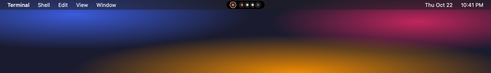
</p>

**What happens if Earshot is not running?**
Ordinary permission requests go to the terminal dialog as usual. The policy still applies, because the hook reads it directly: Block rules still block, and Ask rules fall back to Claude Code's own prompt in the terminal.

**Can Earshot answer for me when I am away?**
No. Nothing is approved without a click. The policy can only hold or block commands, never approve them.

**Does it cost anything?**
No. Earshot is MIT licensed and free. It does not need an Apple developer account: the app is ad-hoc signed, which is why macOS asks you to confirm the first launch.

## Contributing

Bug reports, terminal adapters and small focused fixes are welcome. Read [CONTRIBUTING.md](CONTRIBUTING.md) first; the short version is: no dependencies, no network code, keep it small. Security issues go through [SECURITY.md](SECURITY.md).

## License

[MIT](LICENSE), Copyright (c) 2026 Kirill Novikov.

Earshot is not affiliated with or endorsed by Anthropic. Claude and Claude Code are trademarks of Anthropic.
